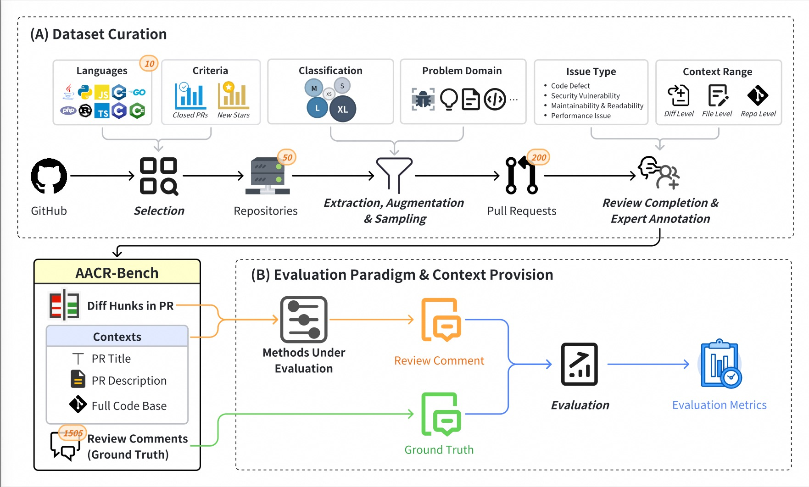

[//]: # (# AACR-Bench: Multi-lingual, Repository-level Context-aware Automated Code Review Benchmark)


<div align="center">

<h1>AACR-Bench</h1>
<p>A multilingual benchmark for automated code review with repository-level context.</p>

[](https://arxiv.org/abs/2601.19494)
[](https://huggingface.co/datasets/Alibaba-Aone/aacr-bench)
[](LICENSE)


English | [简体中文](README.zh-CN.md)

</div>

## Datasets

AACR-Bench evaluates how well large language models identify code issues using repository context across multiple programming languages. The original dataset covers **200 unique pull requests (PRs) from 50 open-source projects across 10 programming languages**. Reference comments came from original review discussions and model-generated feedback, then were annotated by experts.

The dataset covers **C, C++, C#, Go, Java, JavaScript, PHP, Python, Rust, and TypeScript**. Comments are annotated as Code Defect, Maintainability and Readability, Performance, or Security Vulnerability, with context labels for code changes, files, or the repository.

Two versions are available:

- **v1** is the original benchmark version, containing both positive and negative examples.
- **v2** is a subset of v1's positive examples, containing selected high-value review comments and their corresponding pull requests.

The table reports the positive reference data used for evaluation:

| Version | PRs | Reference comments | Repositories |
| --- | ---: | ---: | ---: |
| [v1 (positive)](dataset/v1/positive_samples.json) | 196 | 1,506 | 50 |
| [v2](dataset/v2/positive_samples.json) | 151 | 944 | 42 |

`evaluation/` contains the pipeline for generating review comments and evaluating them against the positive references listed above. v1 also provides a [negative dataset](dataset/v1/negative_samples.json) containing 155 PRs and 639 comments; the positive and negative files together cover 200 unique PRs.



## Quick Start

This example uses the **v2 dataset and OpenCodeReview**. Obtain this repository's source, then start in the `aacr-bench` directory.

See the [evaluation guide](evaluation/README.md) for model configuration, concurrent review, review-only runs, evaluation of saved results, and repository setup.

Python 3.11 or newer is supported; the example uses Python 3.12. Install [uv](https://docs.astral.sh/uv/) and Git. OpenCodeReview requires Git 2.41 or newer. Installing reviewer packages through npm also requires Node.js and npm.

### 1. Install

```bash
cd evaluation
uv venv .venv --python 3.12
uv pip install -r requirements.txt
source .venv/bin/activate
npm install -g @alibaba-group/open-code-review
```

The example installs OpenCodeReview. Other reviewers can be installed with:

| Reviewer | Install command |
| --- | --- |
| Claude Code | `npm install -g @anthropic-ai/claude-code` |
| Codex | `npm install -g @openai/codex` |

Run all subsequent commands inside `evaluation/` with the virtual environment active.

### 2. Configure Models

```bash
if [ ! -e .env ] && [ ! -L .env ]; then
  cp -n .env.example .env
fi
chmod 600 .env
```

The copy preserves an existing `.env`. Edit that file using [.env.example](evaluation/.env.example) to configure the review model and judge:

| Purpose | Variables |
| --- | --- |
| OpenCodeReview review | `OCR_LLM_URL`, `OCR_LLM_TOKEN`, `OCR_LLM_MODEL`; optional `OCR_USE_ANTHROPIC` |
| Judge evaluation | `JUDGE_BASE_URL`, `JUDGE_API_KEY`, `JUDGE_MODEL` |

The program loads `.env` automatically; matching variables passed from the terminal take precedence. Missing `JUDGE_API_KEY` or `JUDGE_USE_MOCK=true` selects local similarity for workflow checks. Configure a real judge to compare model performance.

### 3. Convert and Preview

```bash
python -m converters.aacr_bench --version v2 --seed 42 --validate

python -m pipeline run --stage review --reviewer ocr \
  --dataset data/aacr_bench_v2.jsonl \
  --limit 2 --preview --run-id v2-preview
```

Conversion randomly orders the samples; using the same random seed, such as `--seed 42`, with the same input produces the same sample order. `--limit 2` processes only the first two samples in the converted JSONL file (one JSON object per line). Conversion overwrites its output; you should use a new `--output` path when changing the input or sampling options, and preserve the original data file and order for saved runs. Preview checks the required commits and diff without calling the review model; `--stage review` prevents judge evaluation at this step.

### 4. Review and Evaluate

```bash
python -m pipeline run --reviewer ocr \
  --dataset data/aacr_bench_v2.jsonl \
  --limit 2 --run-id v2-baseline
```

The review stage calls the review model to generate comments. Judge evaluation calls the judge model for semantic matching in real-judge mode, or calculates local similarity in simulation mode. The program then computes metrics. Both stages process the same first two samples.

Review results are saved to `results/aacr_bench_v2/ocr/v2-baseline/`, and metrics to `metrics/aacr_bench_v2/ocr/v2-baseline/`. Use a different run name for a new review to preserve earlier results.

For v1, select `--version v1` and use `data/aacr_bench.jsonl`. After configuring the corresponding agent and model, select `--reviewer claude` or `--reviewer codex` to use another reviewer.

See the [evaluation guide](evaluation/README.md) for model configuration, concurrent review, review-only runs, evaluation of saved results, and repository setup.


## Evaluation Metrics

Default scoring compares generated comments with references in the same file to identify comments about the same issue, called **file-level semantic coverage**. One generated comment may match several references; it counts toward the precision numerator only if it matches at least one previously unmatched reference.

| Metric | Meaning |
| --- | --- |
| Precision | Generated comments matching at least one previously unmatched reference / all generated comments |
| Recall | Reference comments matched, counted once / all reference comments |
| Balanced Score | Harmonic mean of precision and recall |

Scores measure matches against the released references; an unmatched comment may still report a valid issue. Check `missing_instances`: missing or unreadable files, malformed JSON, and non-object results are excluded from metric denominators. See [metrics.md](docs/metrics.md) for definitions and legacy scoring.

## Documentation

- [Evaluation guide](evaluation/README.md) — installation, model configuration, command options, and result directories.
- [Metrics](docs/metrics.md) — matching, scoring, and audit fields.
- [Alibaba-Aone/aacr-bench](https://huggingface.co/datasets/Alibaba-Aone/aacr-bench) — Hugging Face comment-level dataset.
- [Alibaba-Aone/aacr-bench-repos](https://huggingface.co/datasets/Alibaba-Aone/aacr-bench-repos) — source repository snapshots on Hugging Face.

## Contributing

See [CONTRIBUTING.md](CONTRIBUTING.md) for contribution guidelines.

## License

[Apache License 2.0](LICENSE). Third-party repository snapshots remain under their original repository licenses.

## Citation

If you use AACR-Bench in your research, please cite:

```bibtex
@misc{zhang2026aacrbenchevaluatingautomaticcode,
      title={AACR-Bench: Evaluating Automatic Code Review with Holistic Repository-Level Context},
      author={Lei Zhang and Yongda Yu and Minghui Yu and Xinxin Guo and Zhengqi Zhuang and Guoping Rong and Dong Shao and Haifeng Shen and Hongyu Kuang and Zhengfeng Li and Boge Wang and Guoan Zhang and Bangyu Xiang and Xiaobin Xu},
      year={2026},
      eprint={2601.19494},
      archivePrefix={arXiv},
      primaryClass={cs.SE},
      url={https://arxiv.org/abs/2601.19494},
}
```

## Acknowledgments

Thanks to the [data annotation contributors](CONTRIBUTORS.md) and the open-source maintainers who provided the original PR data.
