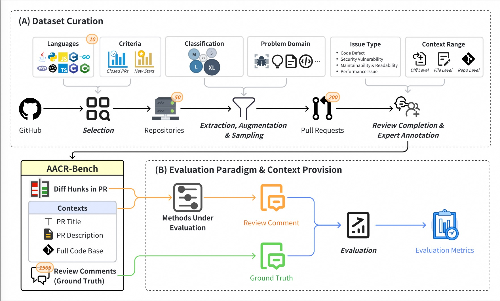

[//]: # (# AACR-Bench: 多语言、仓库级上下文感知的自动化代码评审评测数据集)


<div align="center">

<h1>AACR-Bench</h1>
<p>结合仓库上下文的多语言代码评审评测基准。</p>

[](https://arxiv.org/abs/2601.19494)
[](https://huggingface.co/datasets/Alibaba-Aone/aacr-bench)
[](LICENSE)


[English](README.md) | 简体中文

</div>

## 数据集

AACR-Bench 是一个面向多种编程语言的自动代码评审评测基准，用于评估大语言模型结合仓库上下文发现代码问题的能力。原始数据覆盖 **50 个开源项目、200 个唯一 Pull Request（PR）和 10 种编程语言**。参考评审意见来自原始评审讨论和模型生成的意见，并经过专家标注。

数据集覆盖 **C、C++、C#、Go、Java、JavaScript、PHP、Python、Rust 和 TypeScript**。评审意见分为代码缺陷、可维护性与可读性、性能、安全漏洞四类问题，并标注所需上下文是代码变更、文件还是仓库。

目前提供两个版本：

- **v1**：原始基准版本，包含正例和负例数据。
- **v2**：v1 正例数据的子集，保留其中的高价值评审意见及对应的 PR。

下表统计供评测使用的正例参考数据：

| 版本 | PR 数 | 参考评论数 | 仓库数 |
| --- | ---: | ---: | ---: |
| [v1（positive）](dataset/v1/positive_samples.json) | 196 | 1,506 | 50 |
| [v2](dataset/v2/positive_samples.json) | 151 | 944 | 42 |

`evaluation/` 目录下的评审意见生成和评测流水线使用上述正例数据。v1 另提供[负例数据集](dataset/v1/negative_samples.json)，包含 155 个 PR、639 条评论，正负文件合计覆盖 200 个唯一 PR。



## 快速开始

以下示例使用 **v2 数据集和 OpenCodeReview**。获取本仓库源码后，从 `aacr-bench` 目录开始执行。

模型配置、并发评审、只运行评审、评测已有结果及仓库准备的说明，见[评测指南](evaluation/README.zh-CN.md)。

需要 Python 3.11 及以上，示例使用 Python 3.12。安装 [uv](https://docs.astral.sh/uv/) 和 Git；OpenCodeReview 需要 Git 2.41 及以上。通过 npm 安装评审器时，还需要 Node.js 和 npm。

### 1. 安装

```bash
cd evaluation
uv venv .venv --python 3.12
uv pip install -r requirements.txt
source .venv/bin/activate
npm install -g @alibaba-group/open-code-review
```

示例安装 OpenCodeReview。其他评审器的安装命令如下：

| 评审器 | 安装命令 |
| --- | --- |
| Claude Code | `npm install -g @anthropic-ai/claude-code` |
| Codex | `npm install -g @openai/codex` |

后续命令均在 `evaluation/` 目录中执行，使用已激活的虚拟环境。

### 2. 配置模型

```bash
if [ ! -e .env ] && [ ! -L .env ]; then
  cp -n .env.example .env
fi
chmod 600 .env
```

复制时不会覆盖已有 `.env`。编辑现有文件，按 [.env.example](evaluation/.env.example) 填写评审模型和裁判模型配置：

| 用途 | 配置变量 |
| --- | --- |
| OpenCodeReview 评审 | `OCR_LLM_URL`、`OCR_LLM_TOKEN`、`OCR_LLM_MODEL`；可选 `OCR_USE_ANTHROPIC` |
| 裁判评测 | `JUDGE_BASE_URL`、`JUDGE_API_KEY`、`JUDGE_MODEL` |

程序会自动读取 `.env`；从终端传入的同名环境变量优先。缺少 `JUDGE_API_KEY` 或设置 `JUDGE_USE_MOCK=true` 时，使用本地相似度模拟判定，仅用于检查流程。比较模型表现时需配置真实裁判模型。

### 3. 转换与预览

```bash
python -m converters.aacr_bench --version v2 --seed 42 --validate

python -m pipeline run --stage review --reviewer ocr \
  --dataset data/aacr_bench_v2.jsonl \
  --limit 2 --preview --run-id v2-preview
```

转换时会随机排列样本；对同一份输入数据使用相同的随机种子（如 `--seed 42`），每次得到的样本顺序一致。`--limit 2` 只处理转换后 JSONL 文件（每行一个 JSON 对象）中的前两条样本。重新转换会覆盖输出文件；改变输入或抽样参数时，应该使用新的 `--output` 路径，并保留原实验的数据文件与顺序。预览检查所需提交和代码差异，不调用评审模型；`--stage review` 确保此时不执行裁判评测。

### 4. 评审与评测

```bash
python -m pipeline run --reviewer ocr \
  --dataset data/aacr_bench_v2.jsonl \
  --limit 2 --run-id v2-baseline
```

命令先执行评审阶段，调用评审模型生成意见；再执行裁判评测阶段。在真实裁判模式下，后者调用裁判模型进行语义匹配；本地模拟模式只计算相似度。程序随后计算指标，两个阶段均只处理上述前两条样本。

本示例的评审结果保存在 `results/aacr_bench_v2/ocr/v2-baseline/`，指标保存在 `metrics/aacr_bench_v2/ocr/v2-baseline/`。再次评审时使用不同的运行名称，以保留之前的结果。

使用 v1 时，将转换命令改为 `--version v1`，数据路径改为 `data/aacr_bench.jsonl`。配置相应 agent 和模型后，通过 `--reviewer claude` 或 `--reviewer codex` 选择其他评审器。

模型配置、并发评审、只运行评审、评测已有结果及仓库准备的说明，见[评测指南](evaluation/README.zh-CN.md)。


## 评测指标

默认按文件对照生成意见和参考意见，判断它们是否指出同一问题，称为**文件级语义覆盖**。一条生成意见可以匹配多条参考意见；统计精确率时，至少匹配一条此前尚未匹配的参考意见，才计入分子。

| 指标 | 含义 |
| --- | --- |
| 精确率（Precision） | 至少匹配一条此前未匹配参考意见的生成意见数 / 全部生成意见数 |
| 召回率（Recall） | 被匹配的参考意见数（去重）/ 全部参考意见数 |
| 平衡分数（Balanced Score） | 精确率与召回率的调和平均 |

分数衡量生成意见与参考意见的匹配程度，未匹配的意见仍可能指出真实问题。解读时应查看 `missing_instances`：文件缺失、无法读取、JSON 解析失败或顶层不是对象的结果不计入指标分母。定义及旧评分见[指标说明](docs/zh/metrics.md)。

## 文档

- [评测指南](evaluation/README.zh-CN.md)：安装、模型配置、命令参数与结果保存目录。
- [指标说明](docs/zh/metrics.md)：匹配、评分和审计字段。
- [Alibaba-Aone/aacr-bench](https://huggingface.co/datasets/Alibaba-Aone/aacr-bench)：Hugging Face 评论级数据集。
- [Alibaba-Aone/aacr-bench-repos](https://huggingface.co/datasets/Alibaba-Aone/aacr-bench-repos)：Hugging Face 来源仓库快照。

## 贡献

贡献指南见 [CONTRIBUTING.zh-CN.md](CONTRIBUTING.zh-CN.md)。

## 许可

[Apache License 2.0](LICENSE)。第三方仓库快照遵循原仓库的许可证。

## 引用

在研究中使用 AACR-Bench 时，请引用：

```bibtex
@misc{zhang2026aacrbenchevaluatingautomaticcode,
      title={AACR-Bench: Evaluating Automatic Code Review with Holistic Repository-Level Context},
      author={Lei Zhang and Yongda Yu and Minghui Yu and Xinxin Guo and Zhengqi Zhuang and Guoping Rong and Dong Shao and Haifeng Shen and Hongyu Kuang and Zhengfeng Li and Boge Wang and Guoan Zhang and Bangyu Xiang and Xiaobin Xu},
      year={2026},
      eprint={2601.19494},
      archivePrefix={arXiv},
      primaryClass={cs.SE},
      url={https://arxiv.org/abs/2601.19494},
}
```

## 致谢

感谢[数据标注贡献者](CONTRIBUTORS.md)，以及提供原始 PR 数据的开源项目维护者。
