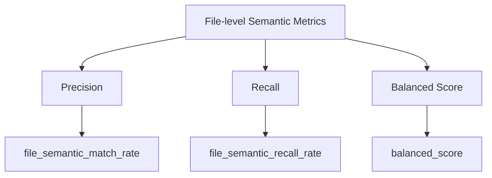

# Evaluation Metrics

## Metrics Overview

AACR-Bench evaluates code review models with a **file-level semantic coverage**
metric system: generated comments are matched against reference (ground-truth)
comments by semantic coverage rather than by one-to-one pairing.



> For why this system replaced the legacy per-comment matching metrics, see
> [metric-migration.md](metric-migration.md).

## Matching Procedure

1. **Group by file.** Reference and generated comments are grouped by
   normalized file path. Diff side and line number are not hard filters; the
   line range is passed to the judge as context only.
2. **One judge call per generated comment.** Each generated comment is compared
   against a numbered list of all reference comments in the same file in a
   single judge-LLM call. The judge returns the numbers of all reference
   comments expressing the same concern — one generated comment may cover
   multiple reference comments (one-to-many coverage).
3. **Greedy dedup for precision.** In generation order, a generated comment
   counts toward precision only if it covers at least one previously uncovered
   reference comment (`hit_new_gt`); re-covering already-covered references is
   a duplicate hit and is excluded from the precision numerator.

Samples whose result files are missing are counted in `missing_instances` and
excluded from all metric denominators. All rates are rounded to 3 decimals.

## Metric Definitions

### 1. Basic Statistics

#### expected_notes (Reference Comments)
- **Definition**: Total number of annotated reference comments with non-empty
  semantic text across evaluated samples
- **Purpose**: Denominator of recall

#### generated_notes (Generated Comments)
- **Definition**: Total number of comments generated by the model across
  evaluated samples
- **Purpose**: Denominator of precision; includes both valid and invalid
  comments

#### matched_file_semantic_notes (Covered Reference Comments)
- **Definition**: Number of reference comments covered by at least one
  generated comment, deduplicated under one-to-many matching
- **Purpose**: Numerator of recall

#### matched_generated_notes (Effective Generated Comments)
- **Definition**: Number of generated comments that covered at least one
  previously uncovered reference comment (`hit_new_gt = true`); duplicate hits
  are not counted
- **Purpose**: Numerator of precision

Sample-size fields `total_instances` / `candidate_instances` /
`evaluated_instances` / `missing_instances` report how many dataset samples
were considered and actually evaluated.

### 2. Performance Metrics

**file_semantic_match_rate (Precision)**: proportion of generated comments that
contribute new ground-truth coverage

```python
file_semantic_match_rate = matched_generated_notes / generated_notes
```

**file_semantic_recall_rate (Recall)**: proportion of reference comments
covered by the model

```python
file_semantic_recall_rate = matched_file_semantic_notes / expected_notes
```

**balanced_score (Balanced Score)**: harmonic mean of precision and recall
(0 when both are 0)

```python
balanced_score = 2 * file_semantic_match_rate * file_semantic_recall_rate \
    / (file_semantic_match_rate + file_semantic_recall_rate)
```

### 3. Per-sample Audit Fields

Each evaluated sample in `eval_res[]` records the judged comments under
`generated_comments[]`:

- `matched_gt_indices`: indices (into the sibling `comments` array) of the
  reference comments this generated comment covers
- `judge_reason`: the judge's per-reference rationale
- `hit_new_gt`: whether the comment covered at least one previously uncovered
  reference comment (false = duplicate hit, excluded from precision)

### 4. Usage Statistics

`total_duration_seconds` / `avg_duration_seconds` and `total_input_tokens` /
`total_output_tokens` / `total_tokens` / `avg_input_tokens` /
`avg_output_tokens` summarize review-stage wall-clock time and token
consumption per run.

## Deprecated Metrics (Legacy Per-Comment System)

The legacy system is available only with `--use-deprecated-score` and will be
removed in a future release. See
[metric-migration.md](metric-migration.md) for why it was replaced.

### Legacy Matching Procedure

The legacy evaluator iterates over each reference comment and scans the
generated comments through four filtering stages:

```
path → side → line(k) → semantic
```

- **path / side**: hard equality on file path and diff side
- **line(k)**: hard gate — the generated comment's line range must overlap or
  be within distance `k` of the reference range (whenever both sides carry
  line information)
- **semantic**: a pairwise judge-LLM call deciding whether the two comments
  express the same concern

Matching is one-to-one with global consumption: each generated comment can
contribute at most one line match and one semantic match per sample.

> **Known limitation: left-side references.** The bundled reviewers (Claude,
> Codex, OCR) review the new code, so `evaluate.py` sets `side` to `"right"` on
> every generated comment. Under the side filter, the 8 reference comments in
> `dataset/positive_samples.json` with `side: "left"` (out of 1,506) cannot be
> matched by these reviewers, yet they still count in the recall denominator.
> The references are kept for reviewers that do comment on the old side
> ([#9](https://github.com/alibaba/aacr-bench/issues/9)). The file-level
> metrics are not affected, because they do not filter on side.

### Legacy Field Definitions

#### matched_semantic_notes (Semantically Matched Comments)
- **Definition**: Number of reference comments for which a semantically
  equivalent generated comment was found
- **Purpose**: Numerator of both semantic precision and recall — under
  one-to-one consumption it equals the number of generated comments consumed
  by semantic matching

#### matched_line_notes (Line-matched Comments)
- **Definition**: Number of reference comments whose location was hit by a
  generated comment (path and side equal, line ranges overlapping or within
  distance `k`)
- **Purpose**: Numerator of both line precision and recall

The denominators `expected_notes` and `generated_notes` are shared with the
file-level system.

### Legacy Metric Calculations

#### Precision Metrics

**semantic_match_rate (Semantic Precision)**: proportion of generated comments
semantically matching an annotated comment

```python
semantic_match_rate = matched_semantic_notes / generated_notes
```

**line_match_rate (Line-level Precision)**: proportion of generated comments
precisely locating an annotated comment

```python
line_match_rate = matched_line_notes / generated_notes
```

#### Recall Metrics

**semantic_recall_rate (Semantic Recall)**: proportion of annotated comments
discovered by the model

```python
semantic_recall_rate = matched_semantic_notes / expected_notes
```

**line_recall_rate (Line-level Recall)**: proportion of annotated comments
discovered and precisely located

```python
line_recall_rate = matched_line_notes / expected_notes
```

#### F1 Metrics

**semantic_f1 / line_f1**: harmonic means of the respective precision/recall
pairs (0 when both are 0)

```python
semantic_f1 = 2 * semantic_match_rate * semantic_recall_rate \
    / (semantic_match_rate + semantic_recall_rate)
line_f1 = 2 * line_match_rate * line_recall_rate \
    / (line_match_rate + line_recall_rate)
```

The result JSON records which system produced the numbers in
`ex_info.score_mode` (`"file_semantic"` | `"deprecated"`). Scores from the two
systems are not comparable.

> Earlier revisions of this document named the legacy fields `positive_*`
> (e.g. `positive_match_rate`) and included an `unmatched_rate` noise metric;
> those names never matched the evaluator's actual output and are not produced
> by any current code path.
