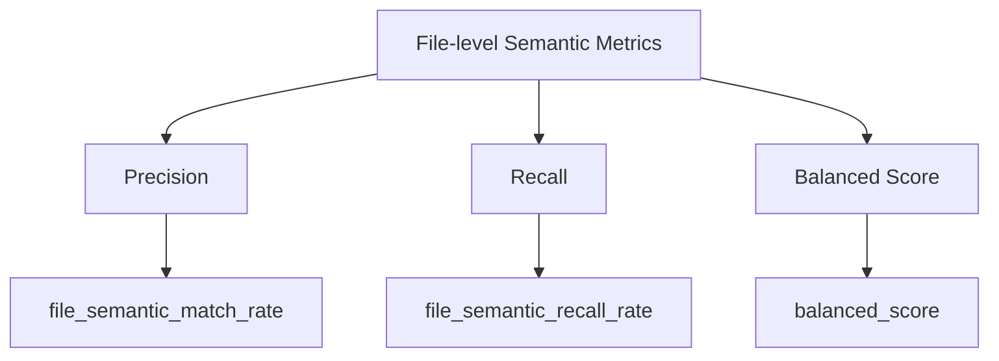

# Evaluation Metrics

## Metrics Overview

AACR-Bench evaluates code review models with a **file-level semantic coverage**
metric system: generated comments are matched against reference (ground-truth)
comments by semantic coverage rather than by one-to-one pairing.



> For why this system replaced the legacy per-comment matching metrics, see
> [metric-migration.md](metric-migration.md).

## Matching Procedure

1. **Group by file.** Reference and generated comments are grouped by
   normalized file path. Diff side and line number are not hard filters; the
   line range is passed to the judge as context only.
2. **One judge call per generated comment.** Each generated comment is compared
   against a numbered list of all reference comments in the same file in a
   single judge-LLM call. The judge returns the numbers of all reference
   comments expressing the same concern — one generated comment may cover
   multiple reference comments (one-to-many coverage).
3. **Greedy dedup for precision.** In generation order, a generated comment
   counts toward precision only if it covers at least one previously uncovered
   reference comment (`hit_new_gt`); re-covering already-covered references is
   a duplicate hit and is excluded from the precision numerator.

Samples whose result files are missing are counted in `missing_instances` and
excluded from all metric denominators. All rates are rounded to 3 decimals.

## Metric Definitions

### 1. Basic Statistics

#### expected_notes (Reference Comments)
- **Definition**: Total number of annotated reference comments with non-empty
  semantic text across evaluated samples
- **Purpose**: Denominator of recall

#### generated_notes (Generated Comments)
- **Definition**: Total number of comments generated by the model across
  evaluated samples
- **Purpose**: Denominator of precision; includes both valid and invalid
  comments

#### matched_file_semantic_notes (Covered Reference Comments)
- **Definition**: Number of reference comments covered by at least one
  generated comment, deduplicated under one-to-many matching
- **Purpose**: Numerator of recall

#### matched_generated_notes (Effective Generated Comments)
- **Definition**: Number of generated comments that covered at least one
  previously uncovered reference comment (`hit_new_gt = true`); duplicate hits
  are not counted
- **Purpose**: Numerator of precision

Sample-size fields `total_instances` / `candidate_instances` /
`evaluated_instances` / `missing_instances` report how many dataset samples
were considered and actually evaluated.

### 2. Performance Metrics

**file_semantic_match_rate (Precision)**: proportion of generated comments that
contribute new ground-truth coverage

```python
file_semantic_match_rate = matched_generated_notes / generated_notes
```

**file_semantic_recall_rate (Recall)**: proportion of reference comments
covered by the model

```python
file_semantic_recall_rate = matched_file_semantic_notes / expected_notes
```

**balanced_score (Balanced Score)**: harmonic mean of precision and recall
(0 when both are 0)

```python
balanced_score = 2 * file_semantic_match_rate * file_semantic_recall_rate \
    / (file_semantic_match_rate + file_semantic_recall_rate)
```

### 3. Per-sample Audit Fields

Each evaluated sample in `eval_res[]` records the judged comments under
`generated_comments[]`:

- `matched_gt_indices`: indices (into the sibling `comments` array) of the
  reference comments this generated comment covers
- `judge_reason`: the judge's per-reference rationale
- `hit_new_gt`: whether the comment covered at least one previously uncovered
  reference comment (false = duplicate hit, excluded from precision)

### 4. Usage Statistics

`total_duration_seconds` / `avg_duration_seconds` and `total_input_tokens` /
`total_output_tokens` / `total_tokens` / `avg_input_tokens` /
`avg_output_tokens` summarize review-stage wall-clock time and token
consumption per run.

## Deprecated Metrics (Legacy Per-Comment System)

The legacy system matched reference comments one-to-one through four stages
(path → side → line(k) → semantic) and produced two metric families, available
only with `--use-deprecated-score`:

| Field | Definition |
|---|---|
| `semantic_match_rate` / `semantic_recall_rate` | per-comment semantic-match precision / recall |
| `line_match_rate` / `line_recall_rate` | per-comment line-overlap precision / recall (within distance `k`) |
| `semantic_f1` / `line_f1` | harmonic means of the above pairs |

The result JSON records which system produced the numbers in
`ex_info.score_mode` (`"file_semantic"` | `"deprecated"`). Scores from the two
systems are not comparable; see
[metric-migration.md](metric-migration.md) for the migration rationale.
