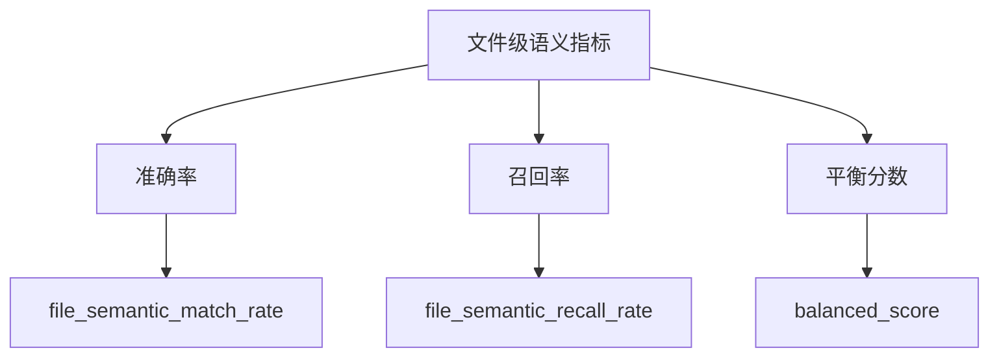

# 评测指标

## 指标体系总览

AACR-Bench 采用**文件级语义覆盖**指标体系评估代码评审模型：生成评论与参考
评论（ground truth）之间按语义覆盖关系匹配，而非逐条一对一配对。



> 该体系取代旧逐条匹配指标的原因见
> [metric-migration.md](metric-migration.md)。

## 匹配流程

1. **按文件分组。** 参考评论与生成评论按归一化文件路径分组；diff 侧别与
   行号不是硬过滤器，行号区间仅作为上下文提供给裁判。
2. **每条生成评论一次裁判调用。** 每条生成评论与同文件内全部参考评论
   组成的编号列表在一次裁判模型调用中比对，裁判返回所有表达相同问题的
   参考评论编号——一条生成评论可覆盖多条参考评论（一对多覆盖）。
3. **准确率贪心去重。** 按生成顺序，一条生成评论只有在命中至少一条此前
   未被覆盖的参考评论时才计入准确率（`hit_new_gt`）；重复覆盖已被覆盖
   参考的评论属重复命中，不计入准确率分子。

找不到结果文件的样本计入 `missing_instances`，不计入任何指标分母。所有
比率保留 3 位小数。

## 指标定义

### 1. 基础统计量

#### expected_notes（参考评论总数）
- 定义：所有已评测样本中语义文本非空的标注参考评论总数
- 作用：召回率的分母

#### generated_notes（生成评论总数）
- 定义：模型在所有已评测样本上生成的评论总数
- 作用：准确率的分母；包含有效与无效评论

#### matched_file_semantic_notes（被覆盖参考评论数）
- 定义：被至少一条生成评论覆盖的参考评论数（一对多匹配下去重）
- 作用：召回率的分子

#### matched_generated_notes（有效生成评论数）
- 定义：命中至少一条此前未被覆盖参考评论的生成评论数
  （`hit_new_gt = true`）；重复命中不计
- 作用：准确率的分子

样本量字段 `total_instances` / `candidate_instances` /
`evaluated_instances` / `missing_instances` 记录数据集中被考虑与实际
评测的样本数。

### 2. 性能指标

**file_semantic_match_rate（准确率）**：贡献了新 ground-truth 覆盖的生成
评论比例

```python
file_semantic_match_rate = matched_generated_notes / generated_notes
```

**file_semantic_recall_rate（召回率）**：被模型覆盖的参考评论比例

```python
file_semantic_recall_rate = matched_file_semantic_notes / expected_notes
```

**balanced_score（平衡分数）**：准确率与召回率的调和平均（二者均为 0 时
为 0）

```python
balanced_score = 2 * file_semantic_match_rate * file_semantic_recall_rate \
    / (file_semantic_match_rate + file_semantic_recall_rate)
```

### 3. 单样本审计字段

`eval_res[]` 中每个已评测样本在 `generated_comments[]` 下记录每条参与
评测的生成评论：

- `matched_gt_indices`：该评论覆盖的参考评论下标（指向同条目的
  `comments` 数组）
- `judge_reason`：裁判对每条参考评论的判定理由
- `hit_new_gt`：是否命中了至少一条此前未被覆盖的参考评论（false 表示
  重复命中，不计入准确率）

### 4. 用量统计

`total_duration_seconds` / `avg_duration_seconds` 与
`total_input_tokens` / `total_output_tokens` / `total_tokens` /
`avg_input_tokens` / `avg_output_tokens` 汇总每次 run 评审阶段的耗时与
token 消耗。

## 已弃用指标（旧逐条匹配体系）

旧体系按 path → side → line(k) → semantic 四个阶段逐条一对一匹配，产出
两族指标，仅在 `--use-deprecated-score` 时可用：

| 字段 | 定义 |
|---|---|
| `semantic_match_rate` / `semantic_recall_rate` | 逐条语义匹配的准确率 / 召回率 |
| `line_match_rate` / `line_recall_rate` | 逐条行号重叠（距离 ≤ k）的准确率 / 召回率 |
| `semantic_f1` / `line_f1` | 上述两对指标的调和平均 |

结果 JSON 通过 `ex_info.score_mode`（`"file_semantic"` | `"deprecated"`）
记录数字由哪套体系产出。两套体系的分数不可比，迁移理由见
[metric-migration.md](metric-migration.md)。
